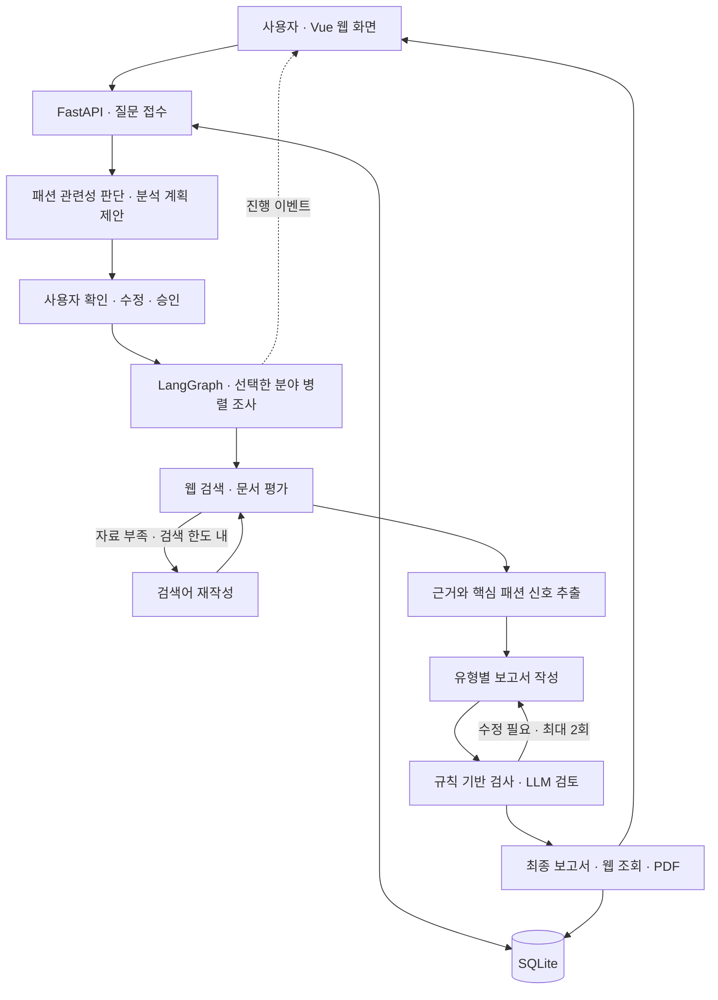
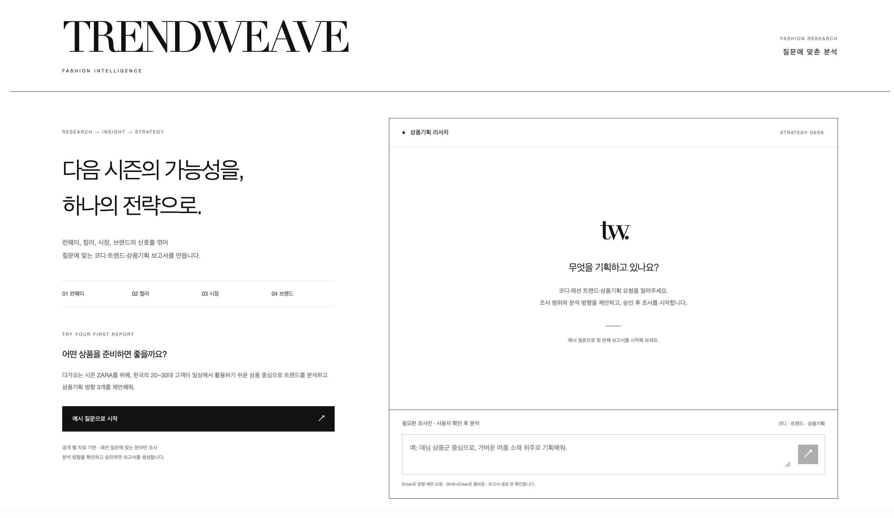
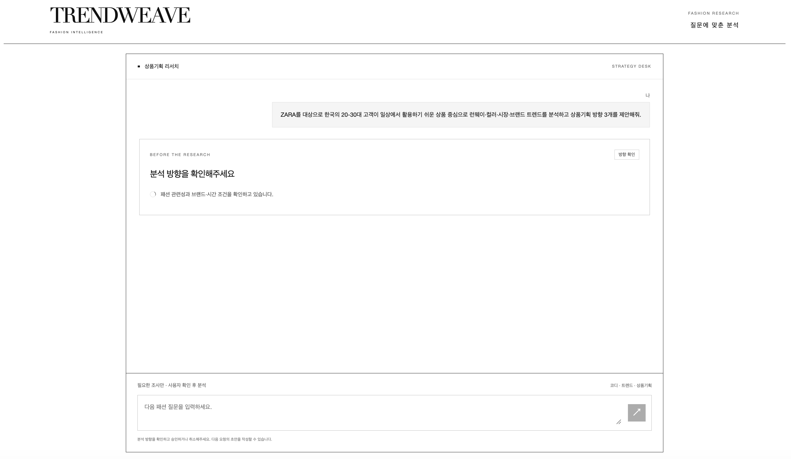
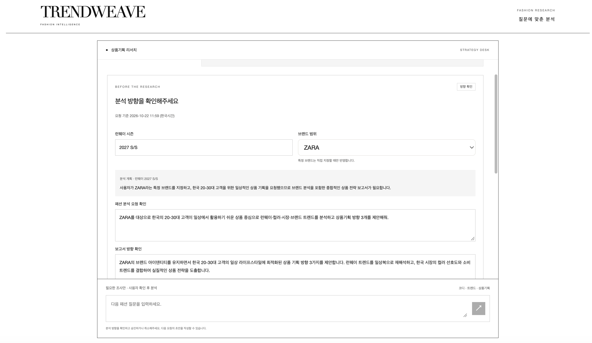
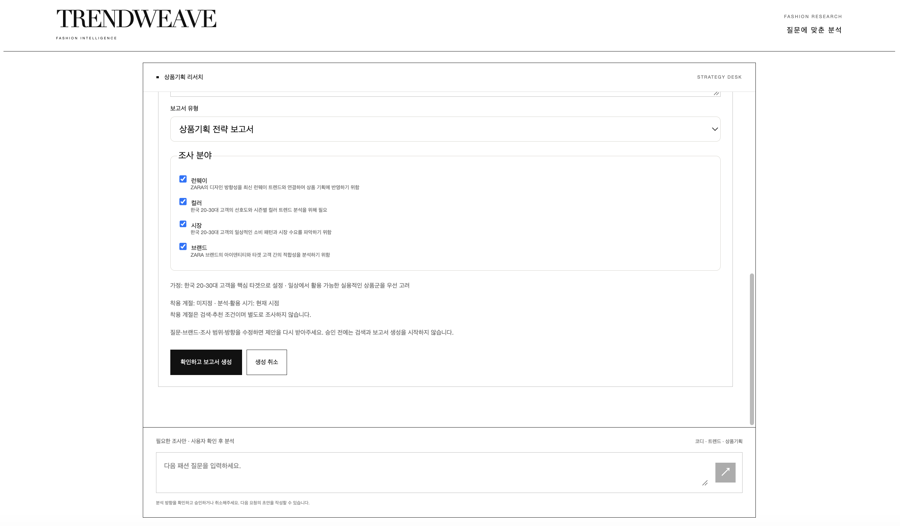
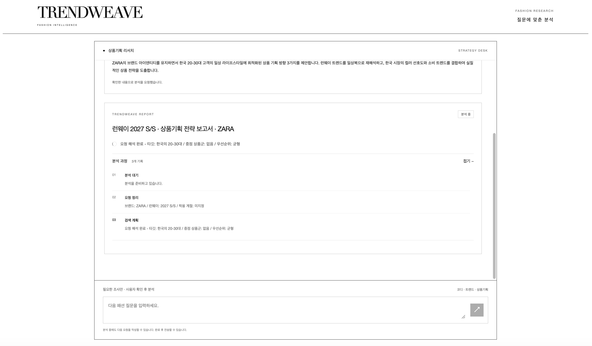
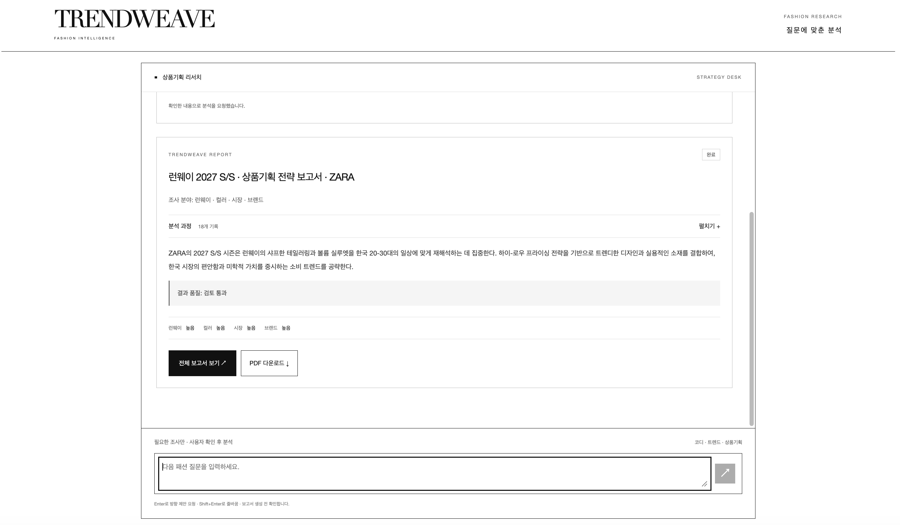

# TrendWeave · 대화형 패션 트렌드 분석 AI Agent

> **작성자 : G140 황민채**
>
> 런웨이·컬러·시장·브랜드 정보를 연결해 사용자 목적에 맞는 패션 분석 보고서를 생성하는 서비스

## 1. 진행 사항 소개

### 1.1 과제 구분 및 선정 주제

본 프로젝트는 **과제 2: 자유주제 프로젝트**로 진행하였다. 주제는 **사용자의 질문을 해석하고 여러 분야의 웹 자료를 조사하여 패션 트렌드와 상품기획 방향을 제안하는 AI Agent 서비스**이다.

의류 브랜드의 상품기획자와 MD는 상품을 기획할 때 런웨이 변화, 컬러 흐름, 소비자 반응, 브랜드 특성을 함께 고려해야 한다. 그러나 관련 정보가 기사, 컬렉션 리뷰, 시장 자료, 브랜드 홈페이지에 흩어져 있어 자료를 수집하고 비교하는 데 시간이 많이 든다. 또한 트렌드를 발견하더라도 이를 실제 아이템·소재·컬러와 연결하는 과정이 필요하다.

이러한 문제를 해결하기 위해 질문에 필요한 자료를 조사하고, 출처와 판단 근거를 함께 제시하는 서비스를 구현하였다.비교적 하이엔드 브랜드의 트랜드를 빠르게 반영하는 SPA 브랜드를 타겟으로 선정하였으며, 그 중 ZARA 상품기획을 활용 사례로 선정하였다. 또한 새로운 시즌 상품 준비를 위한 보고서 작성 뿐만 아니라 브랜드를 지정하지 않은 코디 추천과 일반 트렌드 분석도 지원하도록 확장하였다.

### 1.2 서비스 목표와 주요 사용자

주요 사용자는 패션 상품기획자, MD, 패션 트렌드 조사자 및 코디 정보를 찾는 사용자이다. 목표는 반복적인 자료 수집을 줄이고, 질문 목적에 맞는 보고서와 확인 가능한 참고자료를 제공하는 것이다.

예를 들어 “ZARA의 한국 20~30대 고객을 위한 데님 상품기획 방향 3개를 제안해줘”라는 질문에는 상품기획 전략 보고서를, “요즘 트렌드를 분석해서 여름 출근용 데님 코디를 추천해줘”라는 질문에는 코디 추천서를 생성한다.

### 1.3 주요 Task 및 구현 범위

| 주요 Task                  | 구현 내용                                                               | 제공 결과                               |
| -------------------------- | ----------------------------------------------------------------------- | --------------------------------------- |
| 질문의 관련성 및 의도 판단 | 패션 관련 여부, 보고서 목적, 브랜드와 시간 조건을 해석                  | 분석 계획 또는 추가 확인·지원 범위 안내 |
| 분석 계획 제안 및 승인     | 보고서 유형, 조사 분야, 브랜드, 런웨이 시즌, 보고서 방향 확인·수정      | 사용자 승인에 기반한 분석 요청          |
| 분야별 선택적 리서치       | 런웨이·컬러·시장·브랜드 중 선택한 분야를 병렬 조사                      | 분야별 자료와 핵심 패션 신호            |
| 검색 품질 개선             | 문서 관련성과 필수 정보 충족 여부 평가, 부족한 경우 검색어 수정         | 재검색 결과와 자료 충분도               |
| 보고서 작성 및 검토        | 코디 추천서·트렌드 분석서·상품기획 전략 보고서 작성, 근거 검사와 재작성 | 검토 결과를 포함한 최종 보고서          |
| 진행 기록 및 결과 제공     | 진행 상황 표시, SQLite 저장, 전체 보고서 조회, PDF 다운로드             | 웹 결과 화면과 공유 가능한 보고서       |

브랜드 분석은 ZARA를 기본으로 지원한다. 브랜드 미지정 분석은 특정 브랜드를 기본값으로 붙이지 않으며, 다른 특정 브랜드 분석과 브랜드 비교는 지원 범위를 안내한다.

## 2. 사용한 기술 요소 및 구현 결과

### 2.1 개발 환경 및 기술 스택

개발 환경은 macOS와 Python 3.11을 기준으로 구성하였다.

| 구분           | 사용 기술                             | 적용 내용                                              |
| -------------- | ------------------------------------- | ------------------------------------------------------ |
| 프론트엔드     | Vue 3, HTML, CSS, JavaScript          | 대화 화면, 분석 계획 확인, 진행 기록, 보고서 표시      |
| 백엔드         | FastAPI, Uvicorn                      | 분석 계획·승인·보고서 조회 API 제공                    |
| 진행 상태 전달 | SSE                                   | 분석 단계별 이벤트를 웹 화면에 전달                    |
| Agent 워크플로 | LangGraph, LangChain                  | 조건 분기, 분야별 병렬 조사, 재검색·재작성 흐름        |
| 생성형 AI      | Google Gemini                         | 질문 해석, 검색 계획, 자료 평가·추출, 보고서 작성·검토 |
| 외부 검색      | Tavily Search API, httpx              | 웹 자료 검색과 제한 시간을 적용한 HTTP 호출            |
| 데이터 검증    | Pydantic                              | LLM 구조화 출력 및 분석 조건 검증                      |
| 데이터 저장    | SQLite                                | 분석 계획, 작업 상태, 결과, 진행 이벤트 저장           |
| 보고서 출력    | Markdown, Bleach, Playwright·Chromium | 보고서 렌더링, HTML 정제, 한글 PDF 생성                |
| 테스트         | pytest, Playwright                    | 핵심 로직·API·저장·브라우저 화면 검증                  |

패키지 구성은 [requirements.txt](requirements.txt)와 [requirements-dev.txt](requirements-dev.txt)에서 관리한다.

### 2.2 시스템 구성 및 처리 흐름



사용자 승인 전에는 분석 계획을 제안하고, 승인 후에 본격적인 자료 조사와 보고서 생성을 시작한다. 승인된 작업은 백그라운드에서 실행하며, 분야별 검색은 최대 3회, 보고서 재작성은 최대 2회로 제한하여 반복 실행이 끝나지 않는 문제를 방지하였다.

### 2.3 실제 적용한 핵심 기술

**① Multi-Agent 방식의 역할 분담과 병렬 리서치**

LangGraph에서 검색 계획, 분야별 조사, 보고서 작성, 검토 역할을 노드와 서브그래프로 나누었다. 런웨이·컬러·시장·브랜드 중 선택된 분야만 `Send`로 분기하여 병렬 실행하고, 결과를 모아 보고서를 작성한다. 각 조사 과정은 검색 → 문서 평가 → 필요 시 검색어 재작성 → 핵심 신호 추출 순서로 구성하였다.

역할마다 별도의 모델을 학습한 것은 아니며, 같은 Gemini 모델 설정을 바탕으로 생성용 객체와 평가용 객체, 역할별 프롬프트 및 출력 스키마를 구분하였다. 이를 통해 조사와 검토의 책임을 나누고 흐름을 명시적으로 관리하였다.

**② 검색 증강 생성과 자료 평가**

Tavily에서 수집한 문서의 제목·URL·내용·발행일을 모델에 전달하고, 질문 및 조사 목적에 맞는 자료인지 평가한다. 자료가 부족하면 검색어를 수정하고, 유효한 문서에서 핵심 신호와 문서 ID를 추출하여 보고서 작성에 활용한다.

이는 외부 검색 자료를 근거로 답변을 생성하는 **웹 검색 기반 RAG 방식**이다. 별도의 임베딩 모델이나 벡터 데이터베이스를 구축한 구조는 아니다. 보고서에는 참고자료와 근거 ID를 연결하고, 자료 부족이나 검토 과정에서 남은 문제도 표시하도록 하였다.

**③ 사용자 확인 단계와 구조화 출력**

질문을 입력하면 보고서 유형, 조사 분야, 브랜드, 시즌, 분석 방향을 먼저 보여주고 사용자가 수정·승인하도록 하였다. Pydantic 스키마로 LLM의 출력 형식과 허용값을 검증하고, 서버에서 조사 조건의 일관성을 확인한다. 같은 제안을 중복 승인하여 보고서 작업이 여러 번 생성되는 경우도 방지하였다.

**④ 의존성 주입과 모듈화**

모델과 검색 도구를 `engine.configure()`로 주입하고, `PreviewService`의 계획 생성 함수와 `ReportService`의 실행 함수도 교체할 수 있게 구성하였다. 테스트에서는 실제 API 대신 모의 모델·검색 도구를 주입하여 조건별 동작을 재현한다.

코드는 Agent 처리, 계획 제안, 보고서 작업 관리, 저장, API 라우트, PDF 생성으로 분리하였다. 다만 엔진의 모델 의존성은 모듈 전역에서 공유하는 방식이므로, 향후 요청별 설정을 지원할 때는 객체 단위로 관리하도록 개선할 수 있다.

**⑤ 저장 및 실시간 진행 기록**

SQLite에 분석 계획과 승인 정보, 작업 상태, 최종 결과, 순서가 있는 진행 이벤트를 저장한다. SSE를 통해 분석 진행 상황을 전달하고, 화면에서는 누적 기록을 펼치거나 접어 확인할 수 있다. 완료된 결과는 저장소에서 다시 조회할 수 있으며, 서버 재시작으로 중단된 작업은 실패 상태로 정리하여 재요청을 안내한다.

**⑥ 단위·통합·브라우저 테스트**

pytest로 질문 분류, 조사 조건, 승인, 선택적 리서치, 근거 검사, 재작성 한도, 저장 및 조회를 검증하도록 구성하였다. Playwright를 이용한 브라우저 테스트에서는 분석 계획 승인 흐름, 대화 표시, 누적 진행 기록, 화면 새로고침, 데스크톱·모바일 UI를 다룬다. 한글 PDF 생성과 PDF 오류 시 보고서 상태 유지도 검증 대상으로 포함하였다.

**기술 적용 범위:** 저장소에는 기존 운영 장애 분석 예제의 MCP 서버·클라이언트와 LangSmith 추적 코드가 포함되어 있다. 그러나 현재 기본 실행 모드인 TrendWeave는 해당 MCP 서버를 시작하지 않고 Tavily API를 직접 사용한다. LangSmith 대시보드를 통한 패션 서비스 추적·분석 실적도 이 보고서의 구현 성과로 제시하지 않는다.

### 2.4 기존 기능 개선 및 추가 구현 내용

| 개선 항목         | 개선한 내용                                                                 | 기대 효과                                    |
| ----------------- | --------------------------------------------------------------------------- | -------------------------------------------- |
| 보고서 목적 확장  | ZARA 상품기획 중심 구성에 코디 추천·트렌드 분석·브랜드 미지정 상품기획 추가 | 질문 목적에 맞는 결과 제공                   |
| 조사 범위 선택    | 필요한 조사 분야만 실행하고 사용자가 계획을 확인·수정                       | 불필요한 검색과 요청 의도 불일치 감소        |
| 브랜드 해석 개선  | 브랜드를 지정하지 않은 질문에 ZARA가 임의로 적용되지 않도록 검증            | 사용자 원문 조건 보존                        |
| 시간 조건 분리    | 런웨이 컬렉션 시즌, 실제 착용 계절, 분석·활용 시기를 분리                   | “여름 코디”와 특정 컬렉션 시즌의 혼동 방지   |
| 근거 품질 관리    | 문서 평가·재검색·근거 ID 검사·보고서 검토 적용                              | 근거가 부족한 결론을 식별하고 보완           |
| 상태 및 오류 처리 | 작업 대기량 제한, 검색 재시도, 실패 상태 저장, 중복 승인 방지               | 외부 API 오류와 반복 요청에 대한 안정성 개선 |
| 결과 활용성       | 전체 보고서 조회, 누적 진행 기록, 한글 PDF 다운로드                         | 결과 검토와 공유 편의 향상                   |

### 2.5 검증 내용과 구현 결과

기능 검증은 외부 API 없이 조건을 재현하는 자동화 테스트와 실제 Gemini·Tavily 연동 확인을 구분하여 수행할 수 있도록 구성하였다. 자동화 테스트는 서비스 흐름과 예외 처리를 확인하며, 실제 생성 문장의 정확성이나 패션 제안의 실무 효과까지 보장하지는 않는다.

| 검증 영역      | 확인하는 내용                                             |
| -------------- | --------------------------------------------------------- |
| 질문·조건 해석 | 비패션 질문 안내, 브랜드 미지정 처리, 시즌·착용 조건 분리 |
| 사용자 승인    | 승인 전 작업 미생성, 수정 조건 반영, 중복 승인 방지       |
| 리서치         | 선택한 분야만 실행, 검색 오류·빈 결과 처리, 재검색 한도   |
| 보고서         | 근거 ID 검증, 검토 실패 및 재작성 한도, 남은 문제 표시    |
| 저장·출력      | 결과 재조회, 재시작 시 상태 처리, HTML 정제, 한글 PDF     |
| 웹 화면        | 계획 확인, 대화·진행 기록 표시, 모바일 화면 동작          |

기존 README에는 회귀 테스트 86개 통과 및 실제 API 연동 확인 기록이 기재되어 있었다. 본 초안 작성 시에는 코드를 확인하였으며 테스트나 실제 API 호출을 다시 실행하지 않았다. **최종 제출 시에는 아래 실행 결과와 실제 연동 확인 내용을 최신 검증 기록으로 기입한다.**

```bash
.venv/bin/pip install -r requirements-dev.txt
.venv/bin/python -m pytest -q
```

- 최종 테스트 실행일: [기입]
- 자동화 테스트 결과: [통과 / 실패 / 건너뜀 개수 기입]
- 실제 API 연동 확인: [사용한 질문, 생성 완료 여부, 검토 상태 기입]

### 2.6 기능별 화면 캡처

아래는 ZARA의 한국 20~30대 고객을 위한 상품기획 요청을 기준으로, 질문 입력부터 분석 계획 확인·승인, 자료 조사, 보고서 생성 및 조회까지의 흐름을 캡처한 화면이다.

**입력한 질문:** “ZARA를 대상으로 한국의 20-30대 고객이 일상에서 활용하기 쉬운 상품 중심으로 런웨이·컬러·시장·브랜드 트렌드를 분석하고 상품기획 방향 3개를 제안해줘.”

#### 화면 1. 서비스 초기 화면



TrendWeave의 서비스 소개와 상품기획 리서치 대화 영역을 보여주는 초기 화면이다. 왼쪽에는 “다음 시즌의 가능성을, 하나의 전략으로.”라는 서비스 메시지와 런웨이·컬러·시장·브랜드의 네 가지 분석 분야, 예시 질문으로 시작하는 버튼이 있다. 오른쪽 입력창에서는 코디 추천, 트렌드 분석, 상품기획에 관한 질문을 직접 작성할 수 있다.

#### 화면 2. 질문 입력 및 분석 방향 제안 준비



사용자가 보낸 질문이 대화 상단에 표시되고, AI가 분석 계획을 제안하기 위해 패션 관련성과 브랜드·시간 조건을 확인하는 단계이다. 화면의 “분석 방향을 확인해주세요” 카드에 준비 상태를 표시하며, 아직 자료 조사와 보고서 생성을 시작한 상태는 아니다.

#### 화면 3. 분석 계획 확인 및 요청·방향 수정



질문을 해석한 결과에 따라 런웨이 시즌은 2027 S/S, 브랜드 범위는 ZARA로 제안되어 있다. 사용자는 분석 계획의 설명을 읽고 패션 분석 요청과 보고서 방향을 확인·수정할 수 있다. 화면에서는 한국 20~30대 고객의 일상 라이프스타일에 맞는 상품기획 방향 3개를 제안하고, 런웨이 트렌드와 한국 시장의 컬러 선호도·소비 트렌드를 연결하도록 방향을 설정하였다.

#### 화면 4. 보고서 유형·조사 분야 확인 및 생성 승인



분석 계획 하단에서 보고서 유형과 조사 분야를 확인하는 화면이다. 생성할 보고서 종류와 런웨이·컬러·시장·브랜드의 네 분야와 각 분야를 조사하는 이유가 표시된다. 타깃 고객 등 분석의 가정과 착용 계절·분석 활용 시기도 확인할 수 있다. 사용자가 “확인하고 보고서 생성”을 누르면 조사를 시작하며, “생성 취소”로 요청을 취소할 수도 있다. 질문·브랜드·조사 범위·방향을 변경한 경우에는 제안을 다시 받아 확인하도록 안내한다.

#### 화면 5. 보고서 생성 중 및 누적 분석 과정



승인한 계획에 따라 “런웨이 2027 S/S · 상품기획 전략 보고서 · ZARA” 작업이 진행되는 화면이다. 보고서 카드에 조사 분야와 현재 진행 상태를 표시하고, 펼쳐진 “분석 과정” 영역에 단계별 처리 메시지를 순서대로 쌓는다. 사용자는 분야별 자료 조사와 보고서 생성이 진행되는 과정을 확인할 수 있다.

#### 화면 6. 보고서 생성 완료 및 결과 활용



보고서 생성이 끝나면 상태가 “완료”로 바뀌고 핵심 요약을 보여준다. 사용자는 누적 분석 기록을 다시 펼치거나 “전체 보고서 보기”로 본문을 열 수 있으며, “PDF 다운로드” 버튼으로 보고서 파일을 내려받을 수 있다.

#### 화면 7. 전체 보고서 조회


“전체 보고서 보기”를 선택하면 생성된 보고서를 별도 조회 영역에서 읽을 수 있다. 화면 상단에는 런웨이 시즌, 분석일, 브랜드, 원래 질문과 보고서 방향이 표시되고, 본문에는 Executive Summary와 Research Findings가 이어진다. 캡처에 보이는 런웨이 조사 결과에는 신뢰도, 요약, 실루엣·소재 관련 세부 신호와 근거 번호가 포함되어 있다. 각 근거는 보고서 마지막 References에서 확인하도록 안내하며, 상단에는 PDF 다운로드와 닫기 버튼을 제공한다.

## 3. 느낀 점 및 향후 개선 사항

### 3.1 프로젝트 수행 과정에서 느낀 점

기존의 상품기획 보고서 생성 흐름을 코디 추천과 트렌드 분석 등 다양한 질문에 대응하도록 확장하면서, 사용자 의도에 따라 처리 흐름을 설계하는 것이 중요하다는 점을 느꼈다. 하나의 기능이 동작하는 것과 여러 목적에 유연하게 대응하는 서비스를 만드는 것에는 차이가 있음을 배웠다.

이번 프로젝트를 통해 AI 서비스의 품질은 모델의 답변 능력뿐 아니라 질문 해석, 자료 수집, 검증, 사용자 확인 과정에 의해 결정된다는 점을 배웠다. 같은 패션 질문이라도 사용자가 원하는 결과는 코디 추천, 트렌드 정리, 상품기획으로 달라질 수 있기 때문에 먼저 분석 목적과 범위를 명확히 하는 것이 중요했다.

또한 여러 분야의 자료를 모으는 것만으로는 충분하지 않았다. 자료가 어떤 주장을 뒷받침하는지 연결하고, 근거가 부족할 때 이를 드러내는 과정이 필요했다. 작성과 검토를 분리한 구조를 통해 에이전트의 역할을 나누는 이유를 이해할 수 있었다.

웹 화면과 저장 기능을 연결하면서 모델 실행 이후의 사용자 경험도 중요하다는 점을 느꼈다. 시간이 걸리는 분석의 진행 상황을 보여주고, 실패를 안내하며, 결과를 다시 조회하고 PDF로 활용할 수 있게 만드는 과정까지 포함해야 하나의 서비스가 된다는 것을 경험하였다.

### 3.2 구현 과정의 어려움 및 해결 경험

가장 어려웠던 점은 상품기획 보고서 생성에 맞춰진 기존 흐름을 다른 질문에도 적합하게 바꾸는 과정이었다. 질문 유형에 따라 필요한 조사 분야와 결과 형식이 달라져야 했기 때문에, 질문 의도를 분류하고 조사 범위와 보고서 유형을 선택하도록 수정하였다. 이 과정에서 기존 상품기획 기능도 유지되는지 함께 확인하였다.

| 어려움                                           | 해결 방법 및 배운 점                                                                                                                             |
| ------------------------------------------------ | ------------------------------------------------------------------------------------------------------------------------------------------------ |
| 질문에 없는 브랜드나 조건이 분석에 추가되는 문제 | 브랜드 원문 근거와 서버 검증을 적용하고 브랜드 미지정 상태를 허용하였다. 모델의 해석을 검증하는 계층이 필요함을 배웠다.                          |
| 런웨이 시즌과 실제 착용 계절의 혼동              | 컬렉션 시즌·착용 계절·활용 시기를 별도로 관리하고 런웨이 시즌 필터는 해당 조사에만 적용하였다. 도메인 개념을 데이터 구조에 정확히 반영해야 했다. |
| 검색 자료가 부족하거나 관련성이 낮은 경우        | 문서 평가 후 검색어를 수정하고 재검색하도록 구성하였다. 검색 횟수에 한도를 두고 부족한 근거는 결과에 표시하였다.                                 |
| LLM 출력 형식과 근거의 불안정성                  | Pydantic 구조화 출력, 규칙 기반 근거 검사, LLM 검토와 제한된 재작성 흐름을 조합하였다. 형식 검증과 내용 검토를 함께 다뤄야 했다.                 |
| 오래 걸리는 분석과 중복 실행 관리                | 백그라운드 작업, SSE 진행 표시, 대기량 제한, 중복 승인 방지와 상태 저장을 적용하였다. 모델 외에도 작업 생명주기 관리가 필요했다.                 |
| 한글 보고서를 PDF로 제공하는 문제                | 한글 폰트를 포함한 HTML 템플릿과 Chromium PDF 출력을 사용하였다. 웹 화면뿐 아니라 최종 산출물도 별도 확인해야 했다.                              |

### 3.3 현재 한계 및 향후 개선 방향

| 현재 한계                                                          | 향후 개선 방향                                                                                                                                       |
| ------------------------------------------------------------------ | ---------------------------------------------------------------------------------------------------------------------------------------------------- |
| 공개 웹 검색에 의존하며 실제 판매·재고·원가 데이터를 반영하지 못함 | **사내 RAG 도입:** 내부 문서와 업무 데이터를 활용하여, 외부 트렌드와 사내 상품 운영 현황을 연결하는 실무 중심 분석을 지원한다.                       |
| 텍스트 중심 조사로 런웨이 룩과 상품 이미지를 직접 비교할 수 없음   | **이미지 수집 Agent 도입:** 시각 자료를 자동으로 수집하고, 텍스트와 이미지를 함께 활용하여 컬러·실루엣·디테일을 비교하는 멀티모달 분석으로 확장한다. |

## 부록. 실행 방법 및 주요 코드

### A. 실행 방법

```bash
python3 -m venv .venv
.venv/bin/pip install -r requirements.txt
.venv/bin/python -m playwright install chromium
```

[.env.example](.env.example)을 참고해 `.env`에 `GOOGLE_API_KEY`와 `TAVILY_API_KEY`를 설정한 뒤 실행한다.

```bash
./run.sh
```

- 웹 화면: <http://localhost:8600>
- 백엔드 API: <http://localhost:8100>
- 종료: 실행 터미널에서 `Control + C`

질문 입력 → 분석 계획 확인·수정 → “확인하고 보고서 생성” → 결과 확인 → “전체 보고서 보기” 또는 “PDF 다운로드” 순서로 사용한다.

### B. 주요 코드 위치

| 파일·디렉터리                                                                | 역할                              |
| ---------------------------------------------------------------------------- | --------------------------------- |
| [server.py](server.py)                                                       | FastAPI 시작과 서비스 구성        |
| [agent/trendweave/engine.py](agent/trendweave/engine.py)                     | 계획·분야별 조사·작성·검토 그래프 |
| [agent/trendweave/review.py](agent/trendweave/review.py)                     | 관련성 판단과 분석 계획 검증      |
| [agent/trendweave/schemas.py](agent/trendweave/schemas.py)                   | 구조화 출력 스키마                |
| [services/preview_service.py](services/preview_service.py)                   | 분석 계획 제안 서비스             |
| [services/report_service.py](services/report_service.py)                     | 보고서 백그라운드 실행            |
| [services/report_store.py](services/report_store.py)                         | SQLite 저장과 상태 관리           |
| [services/pdf_service.py](services/pdf_service.py)                           | 보고서 정제와 PDF 생성            |
| [web_chat.html](web_chat.html), [static/trendweave.js](static/trendweave.js) | 웹 화면과 사용자 동작 처리        |
| [tests](tests)                                                               | 자동화 테스트                     |
