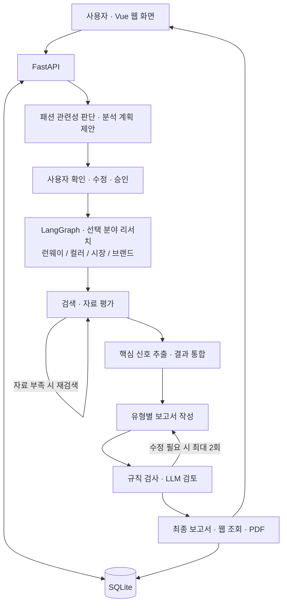
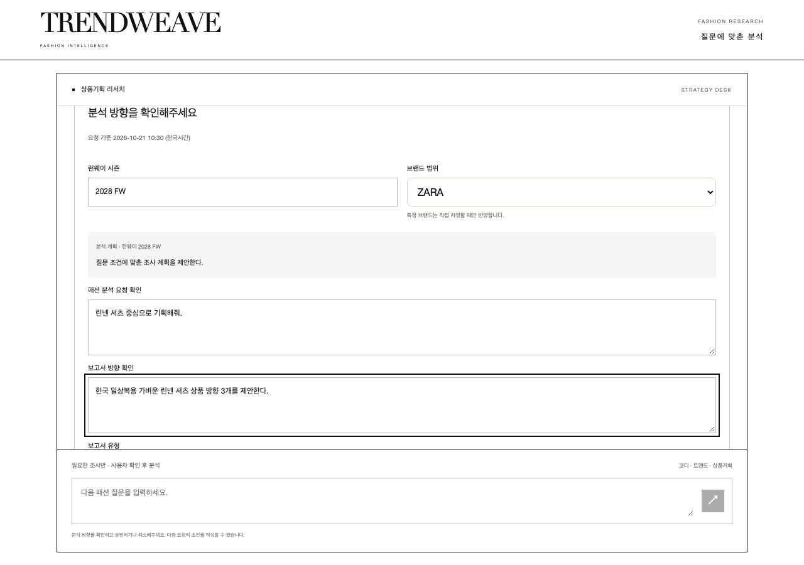

# TrendWeave · 대화형 패션 트렌드 분석 AI Agent

> 런웨이·컬러·시장·브랜드의 정보를 연결해 사용자 질문에 맞는 분석 보고서를 생성하는 AI 서비스

## 1. 프로젝트명 및 주제 선정 배경

SPA 브랜드의 상품기획자와 MD는 판매 시점에 앞서 디자인·컬러의 변화, 소비자 반응, 브랜드 특성을 함께 살펴야 한다. 관련 자료가 패션 기사, 컬렉션 리뷰, 시장 자료, 브랜드 공식 홈페이지에 흩어져 있어 수집과 해석에 많은 시간이 필요하다.

**TrendWeave**는 LLM으로 자료의 핵심 신호를 추출·연결해 **“이 트렌드를 어떤 상품으로 반영할 것인가”**라는 판단을 돕는 AI 리서치 에이전트이다. ZARA 상품기획을 주요 활용 사례로 삼고, 질문 목적에 따라 코디 추천과 트렌드 분석 보고서도 제공한다.

## 2. 해결하고자 하는 문제

| 문제 | 설명 |
|---|---|
| 자료 수집과 통합에 드는 시간 | 여러 출처를 반복해서 검색하고 읽으며 기획에 필요한 정보를 정리해야 한다. |
| 트렌드를 상품으로 구체화하는 어려움 | 유행을 타깃 고객과 활용 목적에 맞는 아이템·컬러·소재로 연결해야 한다. |
| 검색 자료의 품질과 부족한 근거 | 관련 없는 자료를 걸러내고, 정보가 부족하면 추가 조사해야 한다. |
| 추천 근거와 판단 과정의 불명확성 | 추천이 어떤 자료에 기반했는지, 분석 과정에서 무엇을 확인했는지 파악하기 어렵다. |

## 3. 개발 환경 및 기술 스택

개발·검증 환경은 **macOS와 Python 3.11**이다.

| 구분 | 기술 |
|---|---|
| 프론트엔드 | Vue 3, HTML, CSS, JavaScript |
| 백엔드 | FastAPI, Uvicorn, SSE |
| AI Agent | LangGraph, LangChain, Pydantic 구조화 출력 |
| LLM / 검색 | Google Gemini / Tavily Search API |
| 데이터 저장 | SQLite — 분석 계획·작업·보고서·진행 기록 저장 |
| 보고서 | Markdown, Playwright·Chromium PDF |
| 테스트 | pytest, Playwright |

패키지 버전은 [requirements.txt](requirements.txt)와 [requirements-dev.txt](requirements-dev.txt)에서 관리한다.

## 4. 시스템 아키텍처



Tavily가 검색을, Gemini가 자료 해석과 보고서 작성·검토를 담당한다. 분야별 검색은 최대 3회, 보고서 재작성은 최대 2회로 제한한다.

## 5. 주요 구현 기능

- **질문 분석:** 패션 관련성과 목적·브랜드 범위·착용 계절·활용 시기를 파악한다.
- **분석 계획 확인:** 사용자가 보고서 유형·조사 분야·브랜드·런웨이 시즌을 검토하고 승인한다.
- **선택적 조사:** 필요한 분야만 검색하고 자료 평가·재검색을 거쳐 핵심 신호를 추출한다.
- **보고서 생성:** 코디 추천서, 트렌드 분석서, 상품기획 전략 보고서를 작성하고 근거를 검토한다.
- **결과 조회:** 참고자료·자료 충분도·검토 결과·누적 진행 기록을 확인하고 PDF를 다운로드한다.

특정 브랜드 분석은 **ZARA**를 지원하며, 브랜드를 지정하지 않은 질문은 브랜드 범위를 한정하지 않고 분석한다. 컬렉션 시즌은 런웨이 조사에만 적용하고, 착용 계절은 검색·추천 조건으로 활용한다.

## 6. 프로그램 실행 방법

프로젝트 폴더에서 다음 명령으로 실행 환경을 구성한다.

```bash
python3 -m venv .venv
.venv/bin/pip install -r requirements.txt
.venv/bin/python -m playwright install chromium
```

[.env.example](.env.example)을 참고해 `.env`에 Gemini·Tavily API 키를 설정한 뒤 서비스를 실행한다.

```bash
./run.sh
```

- 웹 화면: <http://localhost:8600>
- 백엔드 API: <http://localhost:8100>
- 종료: 실행한 터미널에서 `Control + C`

질문을 입력하고 분석 계획을 확인한 뒤 **확인하고 보고서 생성**을 누른다. 완료 후 **전체 보고서 보기** 또는 **PDF 다운로드**를 선택한다.

예시 질문:

> ZARA의 한국 20~30대 고객을 위한 데님 상품기획 방향 3개를 제안해줘.
>
> 요즘 트렌드를 분석해서 여름 출근용 데님 코디를 추천해줘.

## 7. 테스트 결과 및 실행 화면

검증 기록에서 **회귀 테스트 86개 통과**를 확인했다. 질문 분류·승인·선택적 조사·근거 검사·저장 및 조회와 데스크톱·모바일 UI·한글 PDF 검증을 포함한 결과이다.

```bash
.venv/bin/pip install -r requirements-dev.txt
.venv/bin/python -m pytest -q
```

실제 API 연동에서는 Gemini 미리보기 4건과 Gemini·Tavily 보고서 생성 2건을 확인했다. 생성 결과에 남은 자료·근거의 제약은 검토 상태로 표시했다.

아래는 브라우저 테스트로 확인한 분석 방향 검토 화면이다.



## 8. 개발 과정에서의 문제점 및 해결 방법

## 9. 한계점 및 향후 개선 방향
