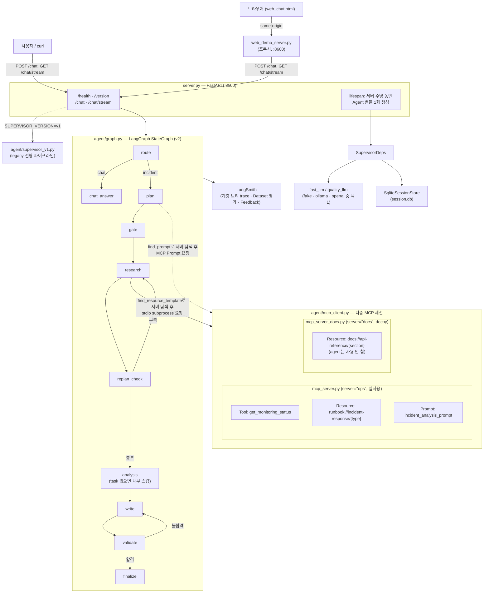
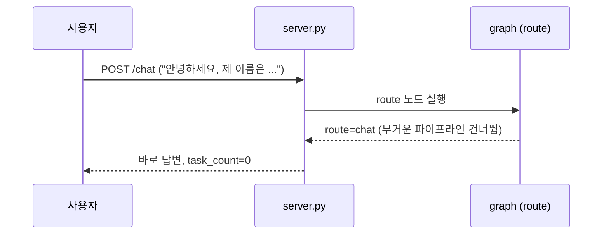
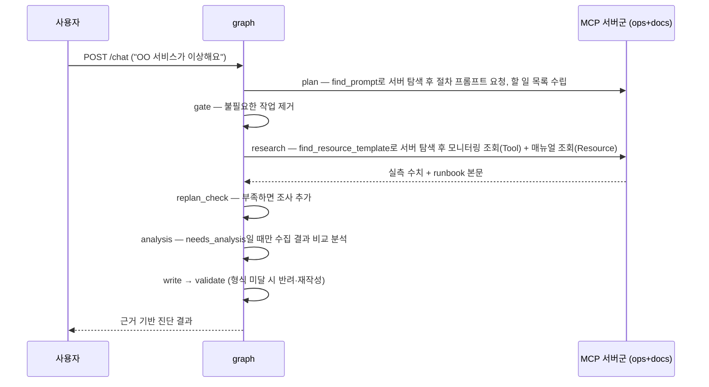
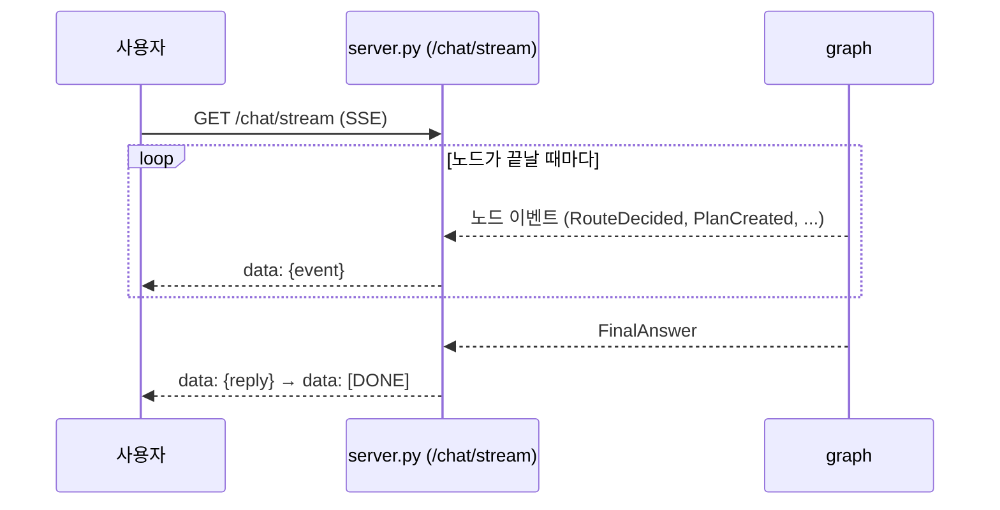
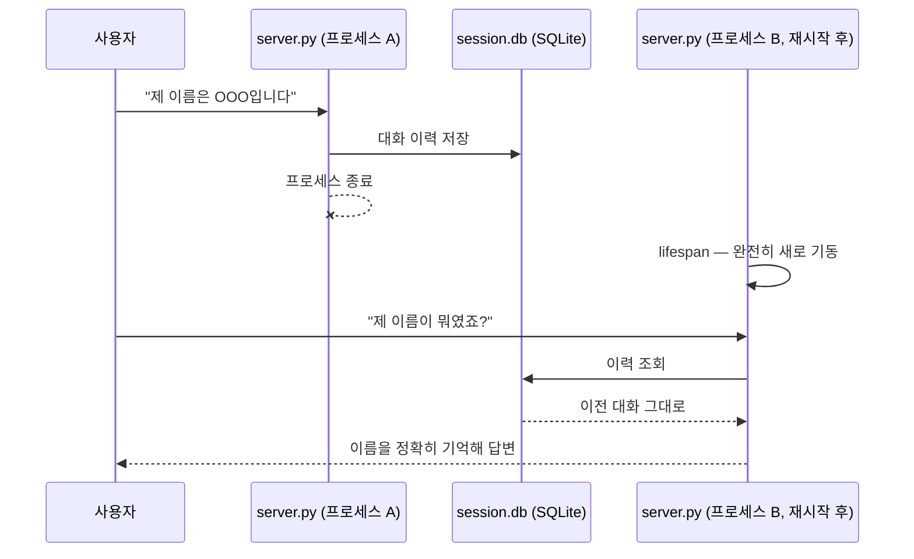
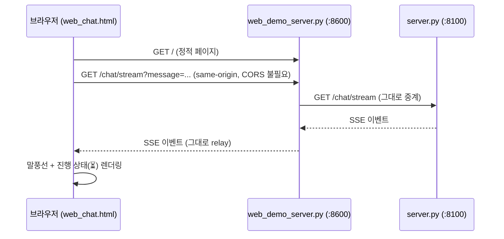

# all_total_vue — 운영 인시던트 대응 에이전트 (Vue 프론트엔드 버전)

`all_total`과 백엔드(server.py, agent/, mcp_server.py 등)는 완전히 동일하고, 브라우저
채팅 화면(`web_chat.html`)만 바닐라 JS 대신 **Vue 3**(CDN 글로벌 빌드, 별도 빌드 단계
없음)로 재작성한 버전이다. 나머지 설명은 원본 `all_total`과 같다.

Wave 1~15가 각각 증명한 패턴(싱글턴·MCP·SSE·라우팅·게이트·재계획·검증·재시도·병렬·비용분리·
세션·주입·버전 토글·가드)을 전부 조립한 **실제 동작하는 에이전트 서비스**다. LLM 자리는
`fake`(결정론)/`ollama`(로컬 실모델)/`openai`(실제 API) 세 백엔드 중 아무거나 꽂을 수 있고,
요청 한 건이 처리되는 전 과정은 LangSmith에 계층 트리로 기록·평가·피드백된다.

## 주요 실행 방법 (macOS)

최상위 폴더의 [README.md](../README.md)에 **가상환경 설치 → `bash run.sh` 실행 → 브라우저 접속** 순서가 정리되어 있습니다. `run.sh` 하나로 백엔드(8100)와 웹 화면(8600)을 함께 실행합니다.

- 기본 테스트: `bash run.sh` (API 키 불필요)
- OpenAI: `.env`에 `OPENAI_API_KEY`를 입력하고 `LLM_BACKEND=openai bash run.sh` (**API 요금 발생**)
- Ollama: Ollama 앱과 모델 준비 후 `LLM_BACKEND=ollama bash run.sh`

> 화면 및 예시: [manual_ollma.md](manual_ollma.md) · [manual_openai.md](manual_openai.md)

## 아키텍처 구성도



- **싱글턴**: `server.py`의 `lifespan`에서 `SupervisorDeps`(LLM·세션·MCP 연결)를 정확히
  1회 생성해 `app.state`로 공유한다 — 요청마다 재생성하지 않는다.
- **백엔드 교체**: `LLM_BACKEND` 환경변수 하나로 `fake_llm.py`/`ollama_llm.py`/
  `openai_llm.py`가 바뀌어 꽂히고, 그래프·MCP·세션 코드는 전혀 바뀌지 않는다.
- **버전 토글**: `SUPERVISOR_VERSION=v1`이면 라우팅·게이트·재계획·검증이 없는 legacy
  선형 파이프라인(`supervisor_v1.py`)으로, 재배포 없이 환경변수만으로 전환된다.
- **MCP는 별도 프로세스**: `mcp_server.py`(ops)가 stdio subprocess로 떠서 서버 수명 동안
  재사용되며, 모니터링 조회(Tool)·대응 매뉴얼(Resource)·진단 절차(Prompt) 세 가지
  capability를 모두 실사용한다.
- **MCP 멀티 서버 탐색**: `mcp_client.py`는 `ops`(mcp_server.py, 실사용)·`docs`
  (mcp_server_docs.py, 내부 API 문서 Resource만 제공하는 decoy) 두 서버에 동시
  연결한다. `plan`/`research` 노드는 어느 서버가 필요한 prompt/resource를 들고
  있는지 코드에 하드코딩하지 않고, `find_prompt()`/`find_resource_template()`로
  연결된 서버들을 먼저 조회한 뒤에야 그 서버로 요청을 보낸다.
- **분석 단계 분리**: `replan_check`가 조사 결과가 충분하다고 판단하면 항상
  `analysis` 노드로 넘어가지만, gate가 살려둔 `agent=="analysis"` task가 없으면
  `analysis_node`가 내부적으로 스킵하고 바로 `write`로 넘어간다 — `needs_analysis`가
  실제로 유효한 경우에만 수집된 모니터링 결과들을 비교 분석한다.

## 주요 유스케이스별 고수준 시퀀스 다이어그램

### 1. 가벼운 대화



### 2. 장애 진단 요청



### 3. 실시간 진행 상황 스트리밍



### 4. 서버 재시작 후 대화 기억



### 5. 웹 채팅 화면 사용



## 소스 디렉토리 구조

```
all_total_vue/
├── server.py              # FastAPI 진입점 — lifespan 싱글턴, /health·/version·/chat·/chat/stream
├── mcp_server.py           # fastmcp 서버("ops") — Tool/Resource/Prompt (실사용, stdio subprocess)
├── mcp_server_docs.py       # fastmcp 서버("docs") — API 문서 Resource만 제공하는 decoy (멀티 서버 탐색 데모용)
├── web_chat.html            # 브라우저 채팅 화면 (정적 1파일)
├── web_demo_server.py       # web_chat.html 서빙 + /chat·/chat/stream·/health 프록시(:8600)
├── requirements.txt
├── README.md               # macOS 실행 가이드
├── run.sh                  # 백엔드+웹 서버 통합 실행
├── .env.example
│
├── agent/
│   ├── deps.py              # SupervisorDeps 의존성 주입
│   ├── graph.py              # v2 LangGraph StateGraph (route/plan/gate/research/replan_check/analysis/write/validate/finalize)
│   ├── supervisor_v1.py      # legacy 선형 파이프라인 (버전 토글 대상)
│   ├── fake_llm.py           # LLM_BACKEND=fake — 결정론적 fast/quality 모델 (route/plan/analyze/chat/write)
│   ├── ollama_llm.py         # LLM_BACKEND=ollama — 로컬 실모델 백엔드
│   ├── openai_llm.py         # LLM_BACKEND=openai — 실제 OpenAI API 백엔드
│   ├── mcp_client.py          # MCP 멀티 서버(ops+docs) stdio 클라이언트 — find_resource_template/find_prompt로 서버 탐색 + 의도적 flaky 1회(재시도 데모)
│   ├── retry.py              # Transient 전용 backoff 재시도
│   └── session_store.py       # SQLite 세션 저장소
│
├── data/
│   ├── monitoring.json        # MCP Tool이 조회하는 모니터링 데이터
│   └── runbooks/               # MCP Resource가 조회하는 대응 매뉴얼 6종
│       ├── db-down.md
│       ├── cpu-spike.md
│       ├── disk-full.md
│       ├── high-latency.md
│       ├── memory-leak.md
│       └── network-timeout.md
│
│
├── doc/                       # 문서
│   ├── README.md                # 이 문서
│   ├── manual_ollma.md          # 사용자 가이드 — 로컬 실모델 기준
│   ├── manual_openai.md         # 사용자 가이드 — OpenAI API 기준
│   ├── regression_test_queries.md  # 시스템명 하드코딩 수정 검증용 회귀 테스트 쿼리 목록
│   ├── image_usecase/           # manual_ollma.md 캡처 이미지
│   └── image_usecase_openai/    # manual_openai.md 캡처 이미지
```
